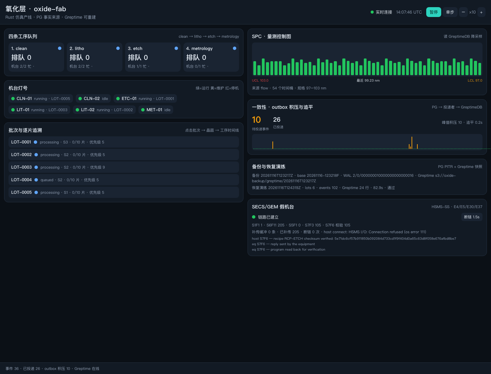
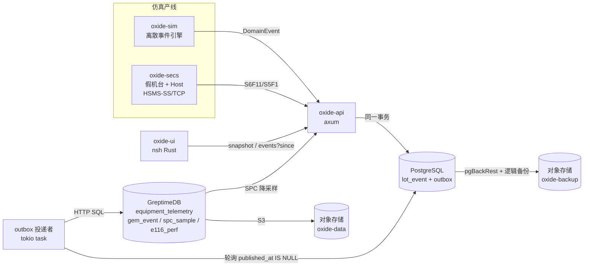

# oxide-fab · 氧化层

一条用 Rust 写成的半导体 CIM 仿真产线：Lot / Wafer 从投料到出片走完四道工序，
**每一次状态变更都先落进 PostgreSQL 的事件日志**，再由事务性 outbox 投递到
GreptimeDB；断链不丢数据，删库能从事件日志重建，备份真做过 PITR 还原演练。




> **边界声明**：这是一个**仿真作品**，机台是假的、SECS/GEM 的对端是假的、
> 部署在单机上。它不是量产 CIM，没有接过真实机台，也没有通过任何 SEMI 认证。
>
> **「防宕机」的含义**：档 A 做的是「断链缓冲 + 重启后重放恢复」，
> **不是自动无感 failover**。RTO 包含容器/进程重启时间。

## 为什么叫 Oxide

三个意思叠在一起：

1. Rust 会氧化——这门语言的核心承诺（内存安全、没有数据竞争）本质上是一层
   氧化膜，成本低、贴得紧，挡住了锈蚀。
2. 晶圆会长 SiO₂ 氧化层——产线里真实存在的一层薄膜，是工艺的一部分。
3. **事件日志也是一层「记录了发生过什么」的薄膜**：PostgreSQL 里的那层是
   事实来源，撕不掉；GreptimeDB 里的那层是派生的，删了可以重新长出来。

## 快速开始

```sh
cp .env.example .env
docker compose up -d --wait
./scripts/smoke.sh
```

`smoke.sh` 会重置演示数据、投 6 个 Lot（每 Lot 10 片）、跑完
清洗 → 光刻 → 刻蚀 → 量测，然后逐片校验四个工序的 genealogy、outbox 是否
全部投递、GreptimeDB 行数是否对得上。

看板：

```sh
cd crates/oxide-ui
nsh run --target web     # 浏览器看板（约 90 秒首次构建后打印地址）
nsh run --target tui     # 终端看板
```

UI 的测试与双目标验证：

```sh
nsh test crates/oxide-ui --junit artifacts/nsh-tests.xml            # Rust + TSX
nsh test crates/oxide-ui --target web  --junit artifacts/nsh-web-tests.xml
nsh test crates/oxide-ui --target tui  --junit artifacts/nsh-tui-tests.xml
nsh package crates/oxide-ui --target web -o dist/web                # release 产物
```

看板默认连 `http://127.0.0.1:8080`；换地址设 `OXIDE_API_URL`。

## 架构



模块依赖方向与写路径细节见 [docs/architecture.md](docs/architecture.md)。

## 双库分工

| | PostgreSQL | GreptimeDB |
|---|---|---|
| 角色 | **唯一事实来源** | 派生、可重建 |
| 内容 | `lot_event`（append-only）、投影、outbox、快照、审计 | 遥测、GEM 事件、SPC 样本、E116 性能 |
| 写入 | 应用事务 | outbox 投递者，至少一次 |
| 丢失后 | 不能丢；靠 PITR | `scripts/replay.sh` 从 `lot_event` 全量重建 |
| 一致性 | 强（单库事务） | 最终一致（幂等键 `event_id`） |

**原则**：任何状态变更先追加事件，再投影到 `lot` / `wafer` / `equipment`，
并在同一个事务里写 `outbox`。事务提交才算成功。

## 一致性契约（本项目最重要的部分）

```mermaid
sequenceDiagram
    participant Sim as 仿真/设备
    participant API as oxide-api
    participant PG as PostgreSQL
    participant Pub as outbox 投递者
    participant GT as GreptimeDB

    Sim->>API: 事件（track_in / track_out …）
    API->>PG: BEGIN
    API->>PG: INSERT lot_event
    API->>PG: UPDATE lot / wafer / equipment
    API->>PG: INSERT outbox(payload = 派生行)
    API->>PG: COMMIT
    API-->>Sim: 202/OK

    loop 每 200 ms
        Pub->>PG: SELECT … FOR UPDATE SKIP LOCKED
        Pub->>GT: INSERT（event_id 在主键里）
        GT-->>Pub: OK
        Pub->>PG: BEGIN; published_at + published_event; COMMIT
    end
```

- GreptimeDB 挂掉时，事件只积压在 PG 的 `outbox`，采集层不丢；恢复后自动追平。
- **PG 与 GreptimeDB 之间没有分布式事务，也没有 2PC**：用 outbox + 幂等键换最终一致。
- 幂等怎么保证：每张表的主键都含 `event_id`，outbox 载荷不可变。
  实测与推理见 [ADR 003](docs/decisions/003-idempotency.md)。
- 重放证明：`scripts/replay.sh` 清空 Greptime 四张表，再用同一个纯函数
  `oxide_core::metrics::derive` 从 `lot_event` 重建，比较行数与 SPC 均值。

## 备份、恢复与演练结果

`scripts/backup.sh` 做四件事，全部落到对象存储的 `oxide-backup` bucket：

1. `pgbackrest --type=full backup`（WAL 持续归档，`archive_timeout=300`）
2. `pg_dump -Fc` + `pg_dumpall --globals-only`（表级恢复用）
3. `greptime cli data export-v2 create/verify`（schema + manifest + parquet）
4. WAL 连续性检查：重置 archiver 计数 → 造一段真实 WAL → switch → 等它落库

`scripts/restore.sh` 严格三步，**在独立 compose project（`oxide-restore`）
的隔离卷里执行**，绝不覆盖运行中的库：

```
down  → 清空隔离实例
pitr  → pgbackrest restore --type=time --target-action=promote
up    → 拉起 → 等 pg_is_in_recovery()=false → 校验
```

最近一次真实演练（`artifacts/restore-latest.json`）：

```json
{
  "target_time": "2026-11-16 16:56:20.969048+00",
  "lots": 6,
  "events": 106,
  "max_created_at": "2026-11-16T16:56:32.341000Z",
  "max_event_at": "2026-11-16T16:57:17.111000Z",
  "greptime_rows": 24,
  "elapsed_ms": 81502,
  "ok": true
}
```

校验项：`pg_is_in_recovery()`、`pg_last_wal_replay_lsn()`、
`pg_last_xact_replay_timestamp()`、业务行数、`max(created_at)`，以及把
Greptime 快照 import 到隔离实例后 `equipment_telemetry` 的行数。

> **一个从未被恢复过的备份，在真正需要它的时刻只是一个假设。**
>
> 备份仓库不能和数据库同故障域。本演示用对象存储的独立 volume 承载备份，
> 但仍是**演示级**：同一台机器、同一个 Docker；生产要把仓库放到独立的
> 对象存储与账号下。

## 故障注入实测（RPO / RTO）

`scripts/chaos.sh` 每次运行都会重写 [docs/chaos-report.md](docs/chaos-report.md)，
下面是本机一次真实运行的结果（三个数据面场景 + 一个 SECS 断链场景）：

| 场景 | 做了什么 | RPO（丢事件） | RTO（含重启） | 结论 |
|---|---|---|---|---|
| kill-store | 停 GreptimeDB 30 s，产线继续 | **0**（60 条事件积压在 outbox） | **48.5 s** | 恢复后自动追平，Lot 状态不丢 |
| kill-db | 停 PostgreSQL 10 s | **0** | **18.9 s** | API 全程返回 503，恢复后把内存里那一批提交 |
| secs-reconnect | 断开 HSMS 链路 5 s，产线继续 | **0**（断链期间 37 条 S6F11/S5F1 进入机台 spool） | **5.3 s** | 重连后补传 37 条，unsent=0 |
| restore-drill | 独立实例 PITR 到指定时刻 | **0**（到目标时刻） | **90.8 s** | 行数与 `max(created_at)` 与源库一致 |

> **这是单机重启式恢复，不是自动 failover。** RTO 包含容器重启、WAL 恢复、
> 投递追平的时间；档 B 用 Patroni + etcd 才能谈自动切换。

## SECS/GEM

`oxide-secs` 用 [`secs4rs`](https://github.com/Asuka-00/secs4rs)（Apache-2.0，
`#![forbid(unsafe_code)]`，零运行时依赖）在真实 TCP 上跑 HSMS-SS：

- **S1F1/S1F2** 在线探测
- **S6F11/S6F12** 采集事件上报（开工/完工）
- **S5F1/S5F2** 告警（机台故障）
- **S7F3/S7F4** 配方下发 + **S7F5/S7F6** 回读校验 SHA-256
- **断链补传**：链路断开时事件进设备 spool，重连后先补传

```sh
cargo test -p oxide-secs --test four_behaviors
```

看板上点「断链 1.5s」可以现场演示 spool 增长与补传。选型与实测见
[ADR 002](docs/decisions/002-secs-choice.md)。

## 面试讲解脚本

### 3 分钟怎么讲

1. **先讲业务骨架（40 秒）**：Lot 是片盒，Wafer 是片；四道工序
   清洗 → 光刻 → 刻蚀 → 量测；机台按「桶」建模，派工是手写规则：
   优先级 → FIFO → 设备资格矩阵 → 配方校验。可现场点 `pause/step/speed`
   看队列怎么动。
2. **再讲数据一致性（70 秒）**：PG 是唯一事实来源，所有状态变更先写
   `lot_event`，同事务写投影和 `outbox`；投递者至少一次送到 GreptimeDB，
   主键含 `event_id` 做幂等。**没有 2PC**，用 outbox 换最终一致。
3. **现场制造故障（50 秒）**：`docker compose stop greptimedb`，看板上
   outbox 积压曲线往上走，产线继续跑；`start` 之后自动追平，点数一致。
4. **收尾（20 秒）**：删掉 Greptime 四张表，`./scripts/replay.sh` 从
   `lot_event` 全量重建，行数与 SPC 均值一模一样；备份不是 PPT，是真做过
   PITR 还原的，RPO/RTO 有数。

### 最容易被追问的 5 个问题

**Q1：为什么叫 Oxide？**
Rust 会氧化、晶圆会长 SiO₂ 氧化层、事件日志也是一层膜：PG 里那层撕不掉，
GreptimeDB 里那层删了能重新长出来。名字就是这套架构的比喻。

**Q2：为什么不用 Kafka / 直接双写？**
双写没有原子性：PG 成功、Greptime 失败就永久不一致。outbox 把「写事实」和
「写派生」拆成两步，失败只会重试，不会丢。Kafka 在这个规模是多余组件；
outbox 表本身就是最小的可靠队列。

**Q3：至少一次投递，重复了怎么办？**
每张时序表的主键含 `event_id`，outbox 载荷不可变（时间戳也在里面），
重复投递被 Greptime 的 primary key + time index 合并掉。ADR 003 里有实测：
同一行插两次 count 还是 1；`scripts/idempotency.sh` 会对真实事件重投两次，
delta 必须是 0。

**Q4：PG 挂了怎么办？10 秒里产生的数据呢？**
API 立刻返回 503，不写脏数据；引擎把还没提交的那一批事件留在内存里并暂停
派工，PG 回来后重试提交。RPO 是 0——只要进程没死。进程死了也不丢已提交的
事件：重启走 `snapshot + lot_event` 重放。RTO 实测 17 秒，含重启。

**Q5：为什么 GreptimeDB 可以删？凭什么说能重建？**
因为它的每一行都是从 `lot_event` 用纯函数 `derive(event, route)` 算出来的，
没有第二个写入源。`replay.sh` 会真的 truncate 四张表、重放全部事件，
再比较行数和 SPC 均值，不是口头承诺。

## 已知限制与档 B 路线

现在（档 A）：

- 单机、单 PostgreSQL 主库；恢复是重启式，有停机窗口。
- 机台、SECS/GEM 对端、载具都是仿真的；没有真实 EAP/MES 集成。
- 对象存储与数据库在同一台机器上，备份仓库只是逻辑隔离（演示级）。
- 对象存储用 RustFS 而非 MinIO：MinIO 的公开镜像与二进制已无法获取
  （Docker Hub 401、dl.min.io 410，实测见 [ADR 004](docs/decisions/004-object-store.md)）。
  S3 接口、bucket 名称与所有客户端不变。
- 没有认证/授权，API 是内网演示形态。
- `cargo audit` 忽略两条只涉及 sqlx 可选驱动（`sqlx-sqlite` / `sqlx-mysql`，未编译、未链接）的公告，
  原因写在 [`.cargo/audit.toml`](.cargo/audit.toml)；新增公告仍会让 CI 失败。
- TUI 产物由 nsh 的 `nsh build` + TUI host 组成；nsh 0.5.0 的
  `nsh package` 没有 `tui` 目标（见 release notes）。

档 B（企业版路线）：

- Patroni + etcd：PG 自动选主，把 RTO 从「分钟」压到「秒」。
- GreptimeDB 集群 + Region 多副本，读副本承接看板查询。
- Kafka/Pulsar 作为跨厂采集总线，outbox 投递者改成 producer。
- 真实设备接入：EAP、GEM300、载具管理、SPC 规则引擎。
- 多工厂、跨机房容灾与灰度发布。

## 文档

- [docs/architecture.md](docs/architecture.md) — 分层与模块依赖
- [ADR 001](docs/decisions/001-ui-toolchain.md) — nsh 纯 Rust 模式与实读证据
- [ADR 002](docs/decisions/002-secs-choice.md) — SECS/GEM 选型
- [ADR 003](docs/decisions/003-idempotency.md) — 幂等实现与实测
- [ADR 004](docs/decisions/004-object-store.md) — 对象存储：RustFS 替代 MinIO 的实测原因
- [docs/chaos-report.md](docs/chaos-report.md) — 最近一次故障注入报告（`artifacts/` 下每次运行都会重写）

## 许可证

[Apache-2.0](LICENSE)。
