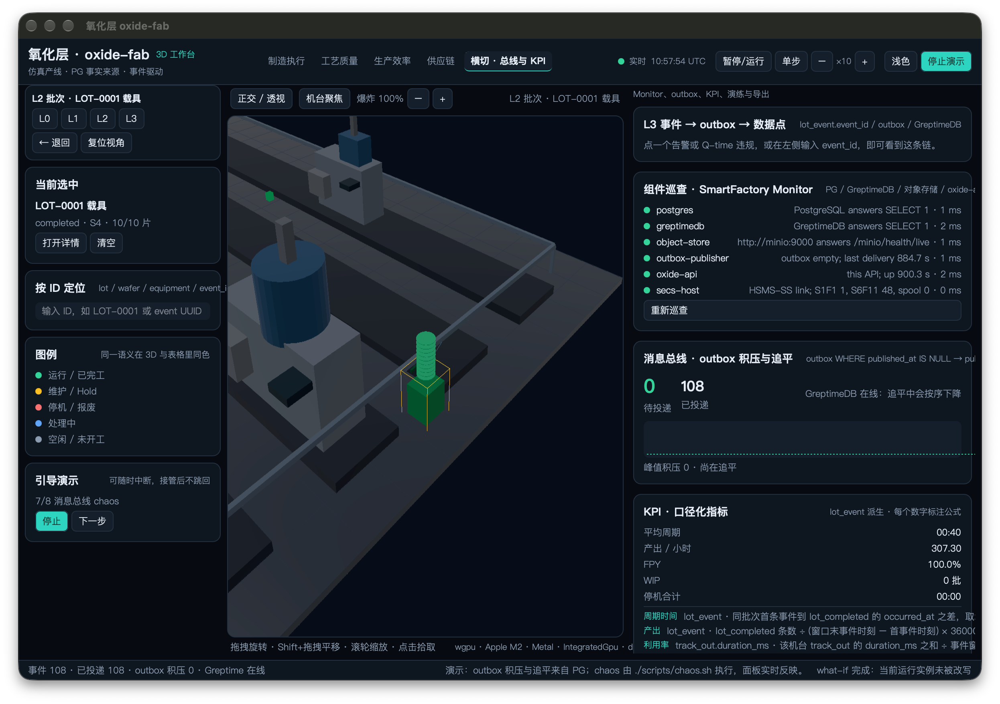
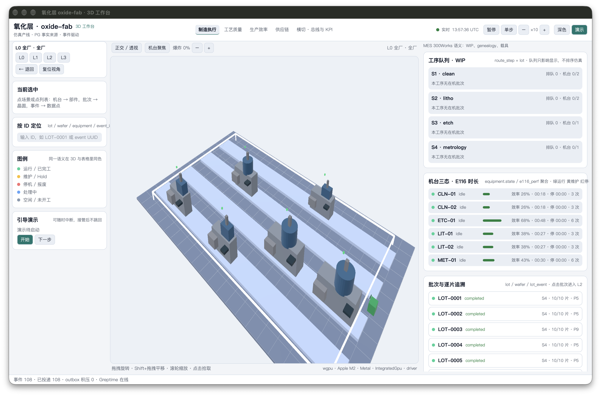

# 视觉方案候选（浅色 / 深色各两套）

本文件是「视觉方案另出候选提案」的交付物。四套方案都已进入过可运行的原型；
**其中浅色 A 与深色 C 已实现并在应用内可一键切换**，因此两张截图不是效果图，而是
macOS 应用的真实窗口截图。B 与 D 是未落地的候选，写清取舍供后续选择。

视觉不改变任何功能：两套主题共用同一套面板、同一份 SceneGraph、同一组口径。

---

## 已落地：两套主题

切换入口在标题栏右侧（`浅色` / `深色`）。切换是全局的：面板、卡片、3D 清屏色、
地面与网格同时换。

### 深色 C · 「Cleanroom Night」（默认）

- **气质**：夜班控制室。深海军蓝底，机台与状态灯是唯一的亮源。
- **色板**：背景 `#070B11`，卡片 `#0E1620`，分层 `#151F2B`，描边 `#22303F`，
  正文 `#E6EDF5`，次文字 `#8B9BB0`；强调青 `#2DD4BF`；状态绿 `#34D399`、
  琥珀 `#FBBF24`、红 `#F87171`、蓝 `#60A5FA`。
- **3D**：清屏 `#070C13`，地面在大面积暗色里用材质明度分层；运行灯为自发光小方块，
  不靠机台整体染色区分三态。
- **适用**：长时间盯屏、演示投影、暗环境。

### 浅色 A · 「Porcelain & Ink」

- **气质**：洁净室白天的纸面感。大量留白、发丝描边、单一青绿重音。
- **色板**：背景 `#F2F5F8`，卡片 `#FFFFFF`，分层 `#E9EEF5`，描边 `#D5DEE9`，
  正文 `#101828`，次文字 `#5B6472`；强调 `#0F766E`；状态绿 `#15803D`、
  琥珀 `#B45309`、红 `#B91C1C`、蓝 `#1D4ED8`。
- **3D**：清屏 `#E8EEF5`；地面与工序带用同一套 GLB 材质，按主题乘以亮化系数
  （4.2×），网格用 `#C3CFDD`，避免深色工厂悬在亮底上的割裂感。
- **适用**：打印、截图进文档、强光环境。

### 两套共用的规则

- **字号**：10.5 / 11.5 / 12.5 / 13.5 px 四级，标题只用字重和字号，不用全大写。
- **间距**：4 的倍数；卡片内 12 px，卡片间 12 px，区块间 8 px。
- **圆角**：卡片 10 px，行 5–7 px，状态点全圆。
- **色彩不是唯一通道**：机台三态同时有机台灯（自发光方块）、文字状态、图例；
  晶圆缺陷同时有颜色和 `defect_info` 文本；层级别用文字面包屑。
- **动效**：只有 FOUP 沿 AMHS 环线 1.4 s 的过渡；`减少动效` 一开关就取消插值，
  所有数值与功能不变。
- **密度**：`标签密度` 关闭卡片右上角的来源/口径行，不改变数据。

---

## 候选 B（浅色，未落地）· 「Blueprint」

- 浅蓝图纸底 `#EAF1F7`，钴蓝 `#1D4ED8` 作唯一重音，1 px 网格作为底纹，
  零圆角、直角卡片、等宽数字。
- 优点：工程图纸气质强，打印和投影都清楚；与「产线」语义贴。
- 未选原因：直角与网格在 400 px 宽的检查器里显得拥挤；大量数据表会像报表
  而不是工作台；网格底纹和 3D 的地面网格互相干扰。

## 候选 D（深色，未落地）· 「Phosphor」

- 近黑 `#050806` 底，单色绿 `#7CFC9A`，文字全部等宽，仅状态点保留琥珀/红。
- 优点：终端气质、极低视觉噪声，适合长时间监控。
- 未选原因：单色削弱了「三类质量告警 + 四域」的区分；截图与灰度打印时状态难辨；
  与 wgpu 场景的材质颜色冲突，3D 会显得像另一套产品。

---

## 选型与理由

落地 **C + A**：

1. 两套都保持「一个强调色 + 三个语义状态色」，把颜色预算留给机台/批次状态，
   而不是装饰；
2. 深色与 3D 场景的暗色清屏一致，浅色则通过材质亮化系数让同一个 GLB 在亮底上
   仍然成立，不需要第二套模型或第二套贴图；
3. 两套的字号、间距、圆角、面板结构完全一致，切换不会改变布局，也不会让验收
   依赖某一种主题。

B 和 D 保留为后续可选项；若选定，只需替换 `crates/oxide-ui/src/palette.rs` 的
两组常量与 `theme.json`，场景亮化系数已经按背景亮度自动选择（浅色 4.2×，
深色 1×），无需改场景或渲染代码。
